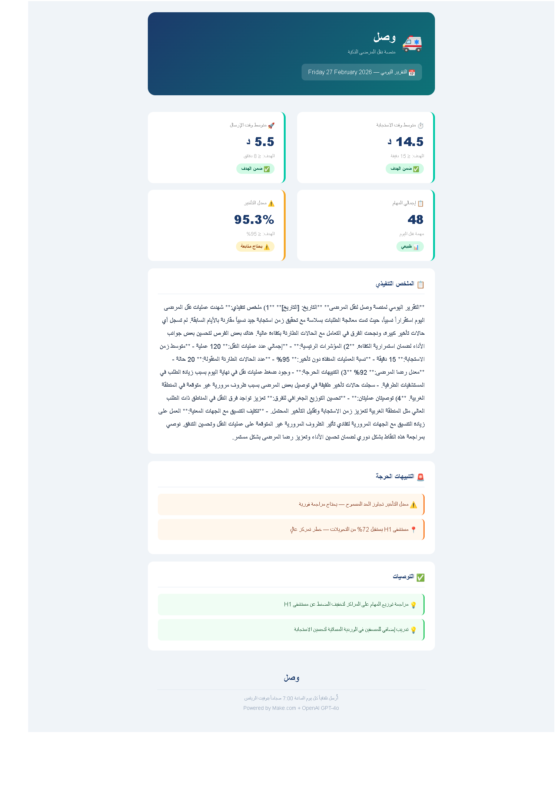

<div align="center">


## ⚡ TL;DR

Wasl is an AI-powered EMS operations intelligence platform 
that transforms medical transport data into real-time operational 
insights and automated daily reports for healthcare leaders.
## 🧠 Executive Dashboard Story

In medical transport operations, hundreds of missions are executed daily between EMS centers and hospitals.

However, operational data is often scattered across multiple reports and systems, making it difficult for decision-makers to quickly understand system performance.

Wasl transforms this operational data into a real-time operational intelligence dashboard.

Through the platform, operations leaders can monitor EMS center performance, response times, fleet readiness, and mission distribution.

In addition, the platform automatically generates AI-powered operational reports to support faster and more informed decision-making.
[](https://moha-111.github.io/Medical-Transport-Operations-Analytics/)
[](https://moha-111.github.io/Medical-Transport-Operations-Analytics/)
[](https://moha-111.github.io/Medical-Transport-Operations-Analytics/)
[](https://moha-111.github.io/Medical-Transport-Operations-Analytics/)
[](./tests/)
[](./LICENSE)

<br/>

> **Innovation Project:** a low-cost, Excel-connected healthcare operations intelligence platform designed to prove value first, automate reports, and learn gradually from operational inputs before any expensive enterprise integration.

### 🌐 [Innovation Platform Preview](https://moha-111.github.io/Medical-Transport-Operations-Analytics/)

</div>

---

## 📋 Table of Contents

- [Overview](#-overview)
- [The Problem](#-the-problem)
- [Live Demo](#-live-demo)
- [Quick Start](#-quick-start)
- [System Components](#-system-components)
- [Key Findings & KPIs](#-key-findings--kpis)
- [System Architecture](#-system-architecture)
- [Data Schema](#-data-schema)
- [Automation Pipeline](#-automation--live-)
- [Analytics Engine](#-analytics-engine)
- [Running Tests](#-running-tests)
- [Roadmap](#-roadmap)
- [Deployment Scenarios](#-deployment-scenarios)
- [Business Model](#-business-model)
- [Data & Templates](#-data--templates)
- [Documentation](#-documentation)
- [Contact](#-contact)

---

## 📌 Overview

**Wasl (وصل)** is an operational intelligence platform designed for private clinics and hospitals to monitor and analyze patient transfer operations. It consolidates **14,169 transfer missions** into a single intelligence layer — covering KPI performance, center benchmarks, paramedic efficiency, and strategic recommendations.

**Wasl** in Arabic means *"to connect"* — connecting patients to hospitals, and decisions to data.

This project demonstrates how **AI-first innovation** can produce enterprise-grade healthcare analytics that is suitable for executive review, controlled pilots, and future production hardening.

### Low-Cost Pilot Principle

The first version is intentionally designed to avoid high implementation cost:

| Principle | Initial Approach |
|-----------|------------------|
| Data source | Use the existing Excel workbook or Google Sheets as the operational database |
| Dashboard | Connect the dashboard directly to the updated file instead of building a new core system |
| Reports | Automate daily executive reports from the same data source |
| Intelligence | Learn from each new incident, referral, department, and transfer reason to improve recommendations over time |
| Integration | Expand to APIs and enterprise platforms only after the pilot proves measurable value |

This keeps the project practical for a master's-stage innovation project while still showing a scalable path.

---

## 🎯 The Problem

## 🚨 Operational Challenges

Medical transport operations involve coordination between EMS centers, ambulances, and hospitals.

However, several operational gaps exist:

| Challenge | Impact |
|-----------|--------|
| Lack of unified operational visibility | Difficult decision making |
| Manual reporting processes | Delayed insights |
| Limited fleet readiness monitoring | Operational inefficiencies |

## 🖥️ Live Demo

<div align="center">

[](https://moha-111.github.io/Medical-Transport-Operations-Analytics/)



*📧 Actual automated email — Professional Arabic report with KPI cards, alerts, and recommendations*

</div>

> **Default login:** Select any role (Operator / Supervisor / Admin) and click **Enter System**. No password required for the demo.

---

## 🚀 Quick Start

### Option 1 — Open the Innovation Platform Preview (No Setup)

```
https://moha-111.github.io/Medical-Transport-Operations-Analytics/
```

### Option 2 — Run Locally

```bash
# 1. Clone the repository
git clone https://github.com/Moha-111/Medical-Transport-Operations-Analytics.git
cd Medical-Transport-Operations-Analytics

# 2. Open the dashboard in your browser
#    (no server required — it's a pure HTML/JS app)
open index.html          # macOS
start index.html         # Windows
xdg-open index.html      # Linux
```

### Option 3 — Import Your Own Data

1. Open the innovation platform preview or your local `index.html`
2. Go to **Data Entry → Import Excel**
3. Upload your `.xlsx` file with mission records
4. The dashboard will auto-calculate all KPIs

> Your Excel file must include columns for Response Time, Dispatch Time, Status, Center, and Month. See the [Data Schema](#-data-schema) section for the full column list.

### Option 4 — Explore the Data with Python

```python
import pandas as pd

# Load the operational dataset
df = pd.read_excel('Medical-Transport-Analytics.xlsx',
                   sheet_name='Daily Operations Data')

# Basic overview
print(f"Total missions:      {len(df):,}")
print(f"Date range:          {df['Month'].unique().tolist()}")
print(f"Active centers:      {df['Center'].nunique()}")
print(f"Paramedics tracked:  {df['Paramedic ID'].nunique()}")

# KPI calculations
print(f"\n--- Key Performance Indicators ---")
print(f"Avg response time:   {df['Response Time (min)'].mean():.1f} min  (target ≤15)")
print(f"Avg dispatch time:   {df['Dispatch Time (min)'].mean():.1f} min  (target ≤8)")
print(f"Late mission rate:   {(df['Status']=='Late').mean()*100:.1f}%      (target ≤95%)")
print(f"Emergency rate:      {(df['Referral Type']=='Life-Saving').mean()*100:.1f}%")

# Center performance ranking
center_stats = df.groupby('Center').agg(
    missions=('Center', 'count'),
    avg_response=('Response Time (min)', 'mean'),
    late_rate=('Status', lambda x: (x == 'Late').mean() * 100)
).sort_values('missions', ascending=False)

print(f"\n--- Top 5 Centers by Volume ---")
print(center_stats.head().to_string())
```

**Expected Output:**
```
Total missions:      14,169
Active centers:      20
Paramedics tracked:  219

--- Key Performance Indicators ---
Avg response time:   14.5 min  (target ≤15)
Avg dispatch time:    5.5 min  (target ≤8)
Late mission rate:   95.3%      (target ≤95%)
Emergency rate:      35.1%

--- Top 5 Centers by Volume ---
         missions  avg_response  late_rate
Center
C01          1247          13.2       93.1
C02          1103          15.8       97.4
...
```

---

## 🖥️ System Components

```
🚑 Wasl Integrated Platform
│
├── 📊  Main Dashboard            → KPIs + Charts + Center Performance
├── 📡  Live Monitoring           → Updates every 5s + Live Event Log
├── 🗂️  Mission Registry          → 14,169 missions + Search & Filter
├── ➕  Data Entry                → Manual form + Excel Import
├── 🏢  Center Management         → 20 centers + Progress Bars
├── 👨‍⚕️ Paramedic Management      → 219 paramedics + Individual Status
├── 🔄  مسار البلاغات            → 7-Step Referral Pipeline Tracker ★ NEW
├── 🔧  Fault Reports             → Medical & Mechanical fault tracking ★ NEW
├── 📋  Supervisory Report        → Daily supervisory report dashboard ★ NEW
├── 📄  Auto Reports              → PDF generation + Make.com scheduling
├── 🔔  Alert System              → Instant alerts when KPI thresholds exceeded
├── 🚀  Impact Simulation         → Before/after Wasl ROI calculator
├── 🔮  Predictive Analytics      → WMA + seasonal forecasting
├── 📐  KPI Definitions           → Full KPI library with formulas
└── ⚙️  Settings                  → KPI limits + Make.com Webhook config
```

### 🔄 7-Step Referral Pipeline — آلية العمل الرسمية

> **Wasl enforces the official medical transport policy workflow end-to-end:**

| الخطوة | المرحلة | الوصف |
|--------|---------|-------|
| **① 📧** | تشغيل | **استلام إيميل الإحالة** — مركز العمليات يستقبل بلاغ الإحالة |
| **② 📋** | تشغيل | **رفع البلاغ للمركز** — المركز المسؤول يستلم البلاغ |
| **③ ✅** | تشغيل | **استجابة المركز** — تأكيد الاستجابة والتعامل مع الإحالة |
| **④ 🚑** | ميداني | **تحرك المسعف** — المسعف المستلم يتحرك من المركز |
| **⑤ 🏥** | ميداني | **وصول للوجهة** — وصول المسعف للمستشفى المُحيل |
| **⑥ 🔄** | ميداني | **تحرك بالمريض** — مغادرة الوجهة مع المريض |
| **⑦ 🎯** | إنهاء  | **وصول المركز / إنهاء البلاغ** — اكتمال المهمة |

Each referral is tracked in real-time with per-step timestamps, delay flags, and phase KPIs (operational / field / completion).

### Role-Based Access

| Role | Arabic | Access Level |
|------|--------|-------------|
| Admin | مدير | Full access — settings, all data, reports |
| Supervisor | مشرف | Dashboard, reports, center management |
| Operator | مشغل | Mission entry, live monitoring |
| Analyst | محلل | Dashboard, data export, read-only |
| Viewer | مراقب | Dashboard view only |
| Guest | ضيف | Limited demo view |

---

## 🔑 Key Findings & KPIs

| KPI | Value | Target | Status | Description |
|-----|-------|--------|--------|-------------|
| Avg Response Time | 14.5 min | ≤15 min | ✅ Met | Time from call to paramedic arrival |
| Avg Dispatch Time | 5.5 min | ≤8 min | ✅ Met | Time from assignment to vehicle departure |
| Mission Duration | 132.9 min | — | 📊 | Total time from call to mission close |
| Emergency Rate | 35.1% | — | 🚨 | % of life-saving/critical missions |
| Late Rate | 95.3% | ≤95% | ⚠️ Near | % missions exceeding response target |
| H1 Hospital Share | 72.1% | Balanced | ⚠️ High | Concentration at one receiving hospital |

### KPI Threshold Configuration

All thresholds are configurable in **Settings → KPI Thresholds**:

```
Default Thresholds:
  Response Time:    ≤ 15 minutes
  Dispatch Time:    ≤  8 minutes
  Late Rate:        ≤ 95%
  Daily Missions:   ≤ 60 per center
```

---

## 🏗️ System Architecture

```
┌──────────────────────────────────────────────────────────────┐
│                        DATA LAYER                            │
│   Excel (.xlsx) / CSV  →  14,169 records × 25 columns        │
│   Manual Entry Form    →  Real-time mission logging          │
└──────────────────────────────┬───────────────────────────────┘
                               │  parseCSV() / Excel import
┌──────────────────────────────▼───────────────────────────────┐
│                      ANALYTICS ENGINE  (core.js)             │
│                                                              │
│   calcKPIs()         → Aggregate KPIs, center stats          │
│   detectBreaches()   → Threshold monitoring & alerts         │
│   predict()          → WMA + trend + seasonal forecasting    │
│   serialiseCFG()     → Config persistence (localStorage)     │
└────────────────┬──────────────────────────┬──────────────────┘
                 │                          │
┌────────────────▼──────────┐   ┌───────────▼─────────────────┐
│    Wasl Dashboard          │   │   Make.com Automation        │
│    (index.html)            │   │                             │
│                            │   │   07:00 AM → Trigger        │
│  • KPI cards               │   │   GPT-4o → Arabic analysis  │
│  • Chart.js visualizations │   │   Gmail  → Email report     │
│  • Live monitoring (5s)    │   │                             │
│  • Paramedic tracker       │   │   ✅ Runs 365 days/year     │
│  • PDF report generation   │   └─────────────────────────────┘
│                            │
│  GitHub Pages hosting      │
└────────────────────────────┘
```

### Tech Stack

| Layer | Tool | Purpose |
|-------|------|---------|
| **Development** | Claude AI (Vibe Coding) | Full project generation |
| **Data** | Microsoft Excel (.xlsx) | Operational data storage |
| **Frontend** | HTML/CSS/JS + Chart.js 4.4 | Interactive dashboard |
| **Business Logic** | Vanilla JavaScript (core.js) | KPI engine, prediction, alerts |
| **Testing** | Jest 29 | 130 unit tests |
| **Automation** ✅ LIVE | Make.com + OpenAI GPT-4o | Daily Arabic reports |
| **Delivery** ✅ LIVE | Gmail API | Automated email to team |
| **Hosting** | GitHub Pages | Free, instant deployment |

---

## 📐 Data Schema

The operational dataset contains **14,169 mission records** with **25 columns**:

| Column | Type | Example | Description |
|--------|------|---------|-------------|
| `Mission ID` | String | `M-00001` | Unique mission identifier |
| `Date` | Date | `2024-01-15` | Mission date |
| `Month` | String | `January` | Calendar month (used for trends) |
| `Center` | String | `C01` | Originating medical center |
| `Paramedic ID` | String | `P-042` | Assigned paramedic identifier |
| `Vehicle ID` | String | `AMB-07` | Ambulance unit identifier |
| `Shift` | String | `Morning` | Work shift (Morning/Evening/Night) |
| `Hospital` | String | `H1` | Receiving hospital |
| `Referral Type` | String | `Life-Saving` | Mission severity type |
| `Severity` | String | `Critical` | Clinical severity level |
| `Response Time (min)` | Number | `12.5` | Total response time in minutes |
| `Dispatch Time (min)` | Number | `4.2` | Dispatch-to-departure time |
| `Travel Time (min)` | Number | `8.3` | On-road travel time |
| `Duration (min)` | Number | `127` | Total mission duration |
| `Status` | String | `Good` | Mission outcome: Late / Good / Excellent |

> For the complete 25-column schema with all field definitions, see [`docs/DATA-SCHEMA.md`](./docs/DATA-SCHEMA.md).

---

## 🤖 Automation — LIVE ✅

Wasl is connected to a **fully automated reporting pipeline** powered by Make.com + OpenAI:

```
┌──────────────────────────────────────────────────────────┐
│              DAILY AUTOMATION PIPELINE                   │
│                                                          │
│  ⏰ 07:00 AM (Riyadh time)                              │
│      │                                                   │
│      ▼                                                   │
│  Make.com Trigger                                        │
│      │  ← Fetches latest KPI snapshot via Webhook       │
│      ▼                                                   │
│  OpenAI GPT-4o                                          │
│      │  ← Analyzes KPIs, trends, alerts                 │
│      │  ← Generates Arabic narrative + recommendations  │
│      ▼                                                   │
│  Gmail API                                               │
│      │  ← Sends professional HTML email                 │
│      ▼                                                   │
│  Operations Team Inbox  ✅                               │
└──────────────────────────────────────────────────────────┘
```

| Time | Action |
|------|--------|
| ⏰ **7:00 AM daily** | Make.com triggers automatically |
| 🤖 **GPT-4o analyzes** | KPIs, trends, alerts, recommendations |
| 📧 **Arabic report sent** | Professional HTML email to operations team |

> *The system runs 365 days a year with zero manual intervention.*

---

## 🧮 Analytics Engine

The analytics engine (`src/core.js`) provides 8 pure functions:

### KPI Calculation Formula

```
avgResponseTime  = Σ(response_time) / n
avgDispatchTime  = Σ(dispatch_time) / n
lateRate         = (late_missions / n) × 100
excRate          = (excellent_missions / n) × 100
lifeSavePct      = (life_saving_missions / n) × 100
```

### Prediction Algorithm

Combines three signals for forecasting:

```
prediction = (WMA_base + trend_slope × days_ahead) × seasonal_factor

Where:
  WMA_base      = Weighted Moving Average (last 7 points, later = higher weight)
  trend_slope   = (last_value - first_value) / (n - 1)  [over last 7 points]
  seasonal_factor = dayFactors[targetDayOfWeek]  [0 = Sunday, 6 = Saturday]
  confidence    = clamp(92 - variance × 2,  min=55, max=93)
```

### Alert Detection Rules

```
Breach triggered when:
  avgResp   > thresholds.resp           → Response time alert
  lateRate  > thresholds.late           → Late rate alert
  n/365     > thresholds.missionsMax    → Volume alert

Center-level breach:
  center.late > thresholds.late + 1.5  → Center-specific alert
```

> For full algorithm documentation with examples, see [`docs/ALGORITHMS.md`](./docs/ALGORITHMS.md).

---

## ⚡ أقل زمن + أعلى جودة (Fast Quality Mode)

لتحقيق أفضل توازن بين السرعة والجودة في التطوير اليومي:

```bash
# فحص سريع قبل كل commit (يركّز على إيقاف الأخطاء مبكرًا)
npm run quality:fast

# فحص شامل قبل الإصدار/الدمج النهائي
npm run quality:full
```

- `quality:fast`: يوقف الاختبارات عند أول فشل لتقليل زمن التغذية الراجعة.
- `quality:full`: يشغّل الاختبارات كاملة مع التغطية لضمان جودة أعلى قبل التسليم.

---

## 🧪 Running Tests

The project includes **130 unit tests** covering all core business logic:

```bash
# Install dependencies (first time only)
npm install

# Run all tests
npm test

# Run with coverage report
npm run test:coverage

# Watch mode (re-runs on file changes)
npm run test:watch
```

**Test coverage by module:**

| Test File | What It Tests | Tests |
|-----------|--------------|-------|
| `calcKPIs.test.js` | KPI aggregation, averages, center stats | ~30 |
| `config.test.js` | Config serialization/deserialization | ~20 |
| `detectBreaches.test.js` | Alert thresholds, Arabic labels, deltas | ~25 |
| `parseCSV.test.js` | CSV parsing, headers, edge cases | ~15 |
| `prediction.test.js` | WMA, trend slope, seasonal prediction | ~20 |

**Expected output:**
```
 PASS  tests/calcKPIs.test.js
 PASS  tests/config.test.js
 PASS  tests/detectBreaches.test.js
 PASS  tests/integration.test.js
 PASS  tests/parseCSV.test.js
 PASS  tests/prediction.test.js

Test Suites: 6 passed, 6 total
Tests:       130 passed, 130 total
```

---

## 🗺️ Roadmap

```
Now ✅          Phase 1 🔵        Phase 2 🟡         Phase 3 🟠
────────────    ──────────────    ───────────────    ───────────────
MVP Complete    Live Google       WhatsApp Alerts    Multi-Hospital
Daily Reports   Sheets DB         Instant KPI        Cloud Platform
Automated 7AM   Real-time sync    Notifications      Multi-tenant
```

| Phase | Description | Tools | Timeline |
|-------|-------------|-------|----------|
| 🔵 **Phase 1** | Connect Google Sheets as live database | Google Sheets API | Week 1 |
| 🟡 **Phase 2** | WhatsApp instant alerts when KPI exceeded | Make.com + WhatsApp API | Week 2 |
| 🔴 **Phase 3** | Multi-hospital cloud dashboard | Cloud Hosting + Auth | Month 2 |

---

## 🗺️ Deployment Scenarios

> Wasl was designed from day one to serve multiple sectors. Below are the five highest-impact deployment targets.

### 🏥 1. Hospital Transport Departments
Every hospital with 5+ ambulances faces fragmented data, manual reporting, and no real-time visibility. Wasl replaces Excel-and-WhatsApp management with a live operational intelligence layer.

**Value Delivered:** Daily AI reports at 7 AM + instant alerts when response time exceeds target

### 🚑 2. EMS Networks & Regional Operations Centers
Built on **14,169 real EMS-like missions** from a 20-center network. Understands shift handovers, vehicle utilization, late dispatch patterns, and peak-hour distribution.

**Value Delivered:** Center benchmarking + paramedic productivity + peak-hour surge alerts

### 🏛️ 3. Government Health Clusters
Government clusters manage hundreds of daily transfers between facilities. Wasl answers accountability questions in real time with full Arabic UI + PDPL roadmap.

**Alignment:** Fully Arabic UI + PDPL roadmap + aligns with [Vision 2030 Digital Health Strategy](https://vision2030.gov.sa)

### 🚐 4. Private Ambulance Providers
Private operators compete on response time. Wasl gives them data-driven dispatch and automated performance reports for clients.

**Business Model Fit:** 500–1,500 SAR/month subscription — immediate ROI vs. hiring an operations analyst

### 🕌 5. Hajj & Mass Gathering Medical Logistics
Hajj season sees **2+ million pilgrims** with thousands of daily medical transfers. Wasl's real-time monitoring is purpose-built for this scale.

**Unique Advantage:** Arabic-first platform + Saudi operational context + scalable from 1 center to 100+

---

## 💼 Pilot Cost Strategy

The priority is not to sell an expensive platform at the beginning. The priority is to prove impact with the lowest practical setup cost.

| Phase | Scope | Cost Control |
|------|-------|--------------|
| 🔵 **Prototype** | Local dashboard + Excel workbook + manual import | Uses existing files and avoids new infrastructure |
| 🟢 **Pilot** | Google Sheets link + automated daily reports + direct incident entry | Adds automation without full enterprise integration |
| 🟡 **Smart Pilot** | Recommendation learning from repeated inputs and transfer reasons | Improves intelligence from accumulated data |
| 🔴 **Scale Later** | APIs, platform integrations, identity, permissions, and production hosting | Added only after measurable value is proven |

> **Positioning:** start lean, prove value, then scale. The first version should be affordable enough to run during the master's project and credible enough to present to leadership.

### Commercial Roadmap

```
NOW ✅              Q3 2026 🔵           Q1 2027 🟡           Q4 2027 🔴
────────────        ──────────────       ──────────────       ──────────────
Innovation MVP      Pilot Program        First Paying         Full SaaS
Working System      1 Hospital           Customer             Platform
AI Reports Live     Validate Impact      Prove Value          10+ Clients
```

### Why Wasl Will Win

| Advantage | Wasl | Traditional Systems |
|-----------|------|-------------------|
| Full Arabic UI | ✅ | ❌ Rarely |
| AI-powered Arabic reports | ✅ | ❌ |
| WhatsApp instant alerts | ✅ | ❌ |
| Affordable pricing | ✅ | ❌ Expensive |
| Easy to use | ✅ | ❌ Complex |
| Saudi PDPL compliant | ✅ Roadmap | ⚠️ Varies |

### Funding & Support Targets

[](https://www.monshaat.gov.sa)
[](https://stv.vc)
[](https://flat6labs.com)
[](https://vision2030.gov.sa)

### Next Milestones

- [ ] 🔵 Deploy pilot with 1 hospital (free) — collect real feedback
- [ ] 🔵 Add live Google Sheets database integration
- [ ] 🟡 Launch WhatsApp instant KPI alerts
- [ ] 🟡 Register company & apply for Monsha'at support
- [ ] 🟡 Convert to PWA mobile app
- [ ] 🔴 Multi-hospital SaaS platform
- [ ] 🔴 Saudi Ministry of Health certification

---

## 📂 Data & Templates

[](https://docs.google.com/spreadsheets/d/1lFtHLgycKMlTFfpC4YbL_Dsvn2ZprOJARc1imcIBF0g/edit?usp=sharing)
[](https://docs.google.com/spreadsheets/d/1-ZUjvnIdeTTqLc3Z-nyYd8Csftds2e6l/edit?usp=sharing)
[](./Medical-Transport-Analytics.xlsx)

### 📊 ملف Excel الكامل — `Medical-Transport-Analytics.xlsx`

الملف يحتوي على **12 شيت** تغطي جميع جوانب العمليات:

| الشيت | المحتوى | الأعمدة / السجلات | الجديد |
|-------|---------|-------------------|--------|
| 📋 **Executive Summary** | ملخص تنفيذي + KPIs رئيسية | — | — |
| 👨‍⚕️ **Employee Schedules** | جداول المسعفين (219 موظف) | الاسم، المركز، الوردية، الحالة | — |
| 🔧 **Fault Reports** | **بلاغات الأعطال الطبية والميكانيكية** | 11 عمود × 20 بلاغ | ★ جديد |
| 📋 **Supervisory Report** | **التقرير الإشرافي اليومي الشامل** | KPIs + مراكز + توصيات + توقيع | ★ جديد |
| 🔄 **Referral Workflow** | **مسار البلاغات — 7 خطوات** | 15 عمود × 13 إحالة + KPIs | ★ جديد |
| 📊 **Daily Operations Data** | 14,169 مهمة تشغيلية | 25 عمود × 14,169 سجل | — |
| 📈 **KPI Dashboard** | مؤشرات الأداء الشاملة | — | — |
| 🏢 **Center Performance** | أداء 20 مركز | الاستجابة، التأخير، المهام | — |
| 🏥 **Hospital Analysis** | تحليل المستشفيات المستقبِلة | توزيع الحالات، H1–H4 | — |
| 👨‍⚕️ **Paramedic Performance** | أداء المسعفين الفردي | 219 مسعف × مؤشرات | — |
| 🚑 **Ambulance Utilization** | استخدام أسطول الإسعاف | نسبة الانتشار، الصيانة | — |
| ⏱️ **Time Analysis** | تحليل الأوقات والذروة | توزيع ساعي، ذروة الطلب | — |

### 🔗 الملفات الخام — Raw Data Links

| الملف | الوصف | الرابط |
|-------|-------|--------|
| 📊 **البيانات الخام (14,169 مهمة)** | قاعدة البيانات الكاملة × 25 متغير | [فتح في Google Sheets](https://docs.google.com/spreadsheets/d/1lFtHLgycKMlTFfpC4YbL_Dsvn2ZprOJARc1imcIBF0g/edit?usp=sharing) |
| 📋 **نماذج الميدان** | بلاغ المسعف + تشيك الإسعاف + تسليم الوردية + مسار البلاغات | [فتح في Google Sheets](https://docs.google.com/spreadsheets/d/1-ZUjvnIdeTTqLc3Z-nyYd8Csftds2e6l/edit?usp=sharing) |
| 🔄 **مسار البلاغات (7 خطوات)** | قالب تتبع الإحالات من الإيميل حتى الإنهاء | شيت **Referral Workflow** في [ملف Excel](./Medical-Transport-Analytics.xlsx) |
| 🔧 **بلاغات الأعطال** | نموذج بلاغات الأعطال الطبية والميكانيكية | شيت **Fault Reports** في [ملف Excel](./Medical-Transport-Analytics.xlsx) |
| 📋 **التقرير الإشرافي** | نموذج التقرير اليومي الجاهز للطباعة | شيت **Supervisory Report** في [ملف Excel](./Medical-Transport-Analytics.xlsx) |

### 🔄 كيفية استيراد البيانات إلى لوحة التحكم

```
1. افتح لوحة التحكم → أي صفحة تحتوي زر "📥 استيراد من Excel"
2. ارفع ملف Medical-Transport-Analytics.xlsx
3. النظام يحلل تلقائياً 4 شيتات:
   ✅ Employee Schedules  → تحديث جداول المسعفين
   ✅ Fault Reports       → تحديث صفحة بلاغات الأعطال
   ✅ Supervisory Report  → تحديث التقرير الإشرافي
   ✅ Daily Operations    → إعادة حساب جميع KPIs
4. تُعاد رسم لوحة التحكم فور اكتمال الاستيراد
```

---

> **Current Status:** This repository uses **synthetic/demo data** for innovation validation and pilot-readiness review. No real patient information is included.

### Data Protection Roadmap

| Phase | Measure | Status |
|-------|---------|--------|
| 🟡 **Data Anonymization** | All patient identifiers replaced with anonymous IDs | Planned |
| 🟡 **Access Control** | Role-based access — operators see only their center's data | Planned |
| 🟡 **Audit Logging** | Every data access logged with timestamp and user | Planned |
| 🔴 **PDPL Compliance** | Full compliance with Saudi Personal Data Protection Law | Roadmap |
| 🔴 **Data Encryption** | End-to-end encryption for patient transfer records | Roadmap |
| 🔴 **Data Residency** | Data stored exclusively within Saudi Arabia (KSA servers) | Roadmap |

---

## 📚 Documentation

Detailed technical documentation is available in the [`docs/`](./docs/) folder:

| Document | Description |
|----------|-------------|
| [Architecture](./docs/ARCHITECTURE.md) | System design, data flow, component diagrams |
| [Algorithms](./docs/ALGORITHMS.md) | KPI formulas, prediction engine, breach detection logic |
| [Data Schema](./docs/DATA-SCHEMA.md) | Full 25-column data dictionary with types and examples |
| [Deployment](./docs/DEPLOYMENT.md) | Local setup, GitHub Pages, Make.com configuration |
| [API Reference](./docs/API-REFERENCE.md) | core.js function signatures and usage examples |

---

## 💡 Vibe Coding Methodology

Built entirely with **Vibe Coding** — using AI as the primary developer:

1. **Define** the problem in plain language
2. **Request** Claude AI to generate the solution
3. **Iterate** through natural conversation
4. **Deploy** without touching traditional code editors

> *"The best code is the code you never had to write."*

This approach reduced development time from weeks to hours while maintaining professional quality.

---

## Innovation Project Context

**Objective:** Build a data-driven operational solution for healthcare transport and referral operations.
**Approach:** AI-first innovation with rapid prototyping, measurable KPIs, and executive decision support.
**Output:** Complete analytics platform with automated reports, live monitoring, and operational recommendations.
**Next Step:** Validate the model through a controlled pilot with clear governance, data protection, and adoption metrics.

---

## 📬 Contact

<div align="center">

[](https://linkedin.com/in/mohammad-alshehri-b0a579388)
[](https://github.com/Moha-111)

</div>

---

<div align="center">

**Built as an AI-first healthcare innovation project · Powered by Vibe Coding + Claude AI**

*Wasl — Connecting Patients to Hospitals, and Decisions to Data*


</div>
